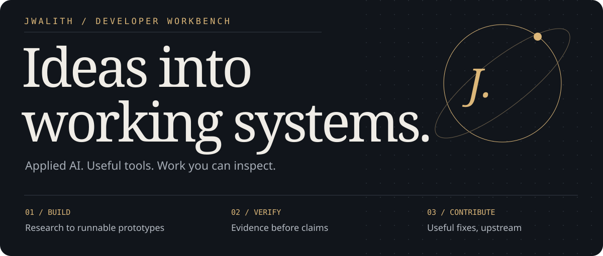
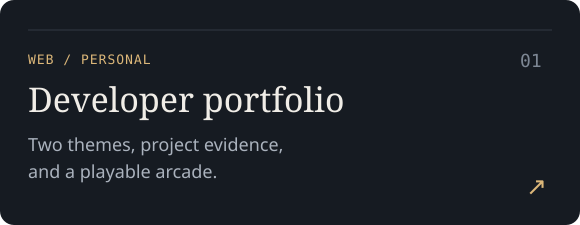
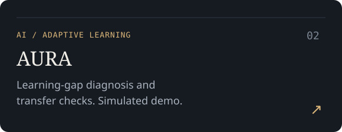
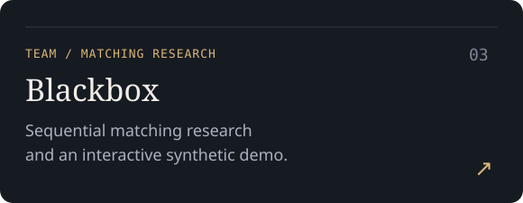
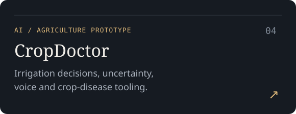
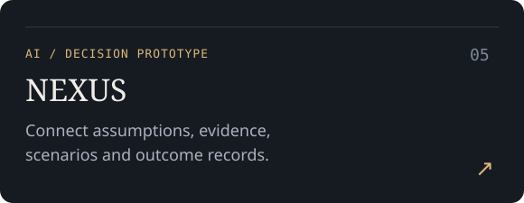
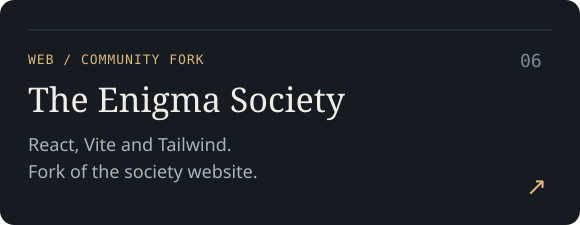

  

  <a href="https://jwalith-portfolio.vercel.app">Portfolio</a> ·

  <a href="#selected-projects">Projects</a> ·
  <a href="#lets-connect">Contact</a> ·

  <a href="#open-source-contributions">Contributions</a> ·

  <a href="https://github.com/jwalith4418-Mj?tab=repositories&amp;type=source">Original repositories</a>

## About me

I'm Jwalith. I build Python tools and explore AI systems for learning, reasoning, and evidence-based decisions. My open-source work focuses on reproducible bugs, focused fixes, regression tests, and maintainer feedback.

Current interests: **developer tooling · applied AI · software verification · adaptive learning**.

## Selected projects

Six projects from my current pins. Open a card to explore the source.

<table>
<tr>
<td width="50%"></td>
<td width="50%"></td>
</tr>
<tr>
<td width="50%"></td>
<td width="50%"></td>
</tr>
<tr>
<td width="50%"></td>
<td width="50%"></td>
</tr>
</table>

Research results, simulation limits, team attribution, and setup instructions live in the linked repositories.

## Open-source contributions

**47 submitted · 24 merged · 18 open · 5 closed unmerged**  

Snapshot: **11 November 2026, 11:58 IST**. Five PRs closed without merging; two were policy/spam rejections. Counts describe this contribution program, not lifetime GitHub activity.

Some merged work:

| Project | Contribution | Evidence |

| --- | --- | --- |

| **Pydash** | Serialize overlapping `once` calls across threads | [Merged PR #406](https://github.com/dgilland/pydash/pull/406) |

| **pyjson5** | Return an error tuple when parsing empty input | [Merged PR #154](https://github.com/dpranke/pyjson5/pull/154) |

| **Wheelgap** | Add offline checks to the Python lockfile API | [Merged PR #182](https://github.com/wheelgap/wheelgap/pull/182) |

| **Mailsuite** | Strip CRLF terminators from captured email header values | [Merged PR #75](https://github.com/seanthegeek/mailsuite/pull/75) |

| **TunnelScope** | Show receiver bind addresses in the text summary | [Merged PR #93](https://github.com/lazypanic999/tunnelscope/pull/93) |

[Full dated contribution register →](CONTRIBUTIONS.md) · [Live merged PR search →](https://github.com/pulls?q=is%3Apr+author%3Ajwalith4418-Mj+is%3Amerged)

AI assistance is part of my workflow. Project-specific review and disclosure rules apply; contribution status is linked to upstream evidence.

## Let's connect

Interested in a project, a research discussion, or working together on a useful open-source issue? Send me a message on LinkedIn or Instagram and mention the repository or idea you have in mind.

[LinkedIn](https://www.linkedin.com/in/madhyahnapu-jwalith/) · [Instagram](https://www.instagram.com/jwalithmadhayahnapu/) · [Portfolio](https://jwalith-portfolio.vercel.app)

## Working approach

1. Understand the project and its contribution policies.

2. Reproduce the problem and check for existing work.

3. Make a focused change with meaningful regression coverage.

4. Run the relevant checks and respond to review.

For new contributions, I prioritize useful, maintainer-supported issues across different organizations. Follow-ups on existing PRs remain maintenance work.

---

Explore the source. Read the evidence. Run the checks.

