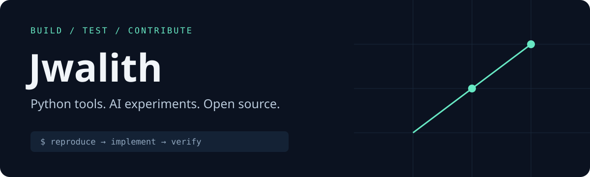

  

  <a href="https://jwalith-portfolio.vercel.app">Portfolio</a> ·
  <a href="#selected-projects">Projects</a> ·
  <a href="#open-source-contributions">Contributions</a> ·
  <a href="https://github.com/jwalith4418-Mj?tab=repositories&amp;type=source">Original repositories</a>

## About me

I'm Jwalith. I build Python tools and explore AI systems for learning, reasoning, and evidence-based decisions. My open-source work focuses on reproducible bugs, focused fixes, regression tests, and maintainer feedback.

Current interests: **developer tooling · applied AI · software verification · adaptive learning**.

## Selected projects

| Project | What I'm exploring | Start here |
| --- | --- | --- |
| **[AURA](https://github.com/jwalith4418-Mj/aura)** | Local-first learning diagnosis with Bayesian gap hypotheses and transfer checks. The current demo uses simulated evidence. | [Run the demos](https://github.com/jwalith4418-Mj/aura#quick-start) |
| **[Aletheia](https://github.com/jwalith4418-Mj/aletheia)** | Grounded answers, adaptive teaching, and reproducible offline evaluations. Learning-effect results are simulations. | [Architecture and evaluation](https://github.com/jwalith4418-Mj/aletheia#the-two-layers) |
| **[CDIS](https://github.com/jwalith4418-Mj/cdis)** | Career evidence scorecards, replayable decisions, and human-approved resume workflows. | [Run locally](https://github.com/jwalith4418-Mj/cdis#quickstart) |
| **[ClimaVerse](https://github.com/jwalith4418-Mj/climaverse)** | Climate-twin proof of concept with ConvLSTM prediction, walk-forward validation, and a FastAPI backend. Uses synthetic data. | [Source and limitations](https://github.com/jwalith4418-Mj/climaverse) |
| **[OpenMythos](https://github.com/jwalith4418-Mj/openmythos)** | Recurrent-depth transformer research, architecture, and experiments. | [Research repository](https://github.com/jwalith4418-Mj/openmythos) |
| **[Developer portfolio](https://github.com/jwalith4418-Mj/jwalith4418-Mj.github.io)** | A plain HTML/CSS/JavaScript portfolio with two themes and an arcade. | [Visit portfolio](https://jwalith-portfolio.vercel.app) |

These are personal projects and research prototypes; their repositories document setup, evidence, and limitations.

## Open-source contributions

**47 upstream PRs submitted · 23 merged · 20 open · 33 repositories**  
Snapshot: **11 November 2026, 07:50 IST**. Four PRs closed without merging; two were policy/spam rejections. Counts describe this contribution program, not lifetime GitHub activity.

Some merged work:

| Project | Contribution | Evidence |
| --- | --- | --- |
| **Pydash** | Serialize overlapping `once` calls across threads | [Merged PR #406](https://github.com/dgilland/pydash/pull/406) |
| **pyjson5** | Return an error tuple when parsing empty input | [Merged PR #154](https://github.com/dpranke/pyjson5/pull/154) |
| **Wheelgap** | Add offline checks to the Python lockfile API | [Merged PR #182](https://github.com/wheelgap/wheelgap/pull/182) |
| **Mailsuite** | Strip CRLF terminators from captured email header values | [Merged PR #75](https://github.com/seanthegeek/mailsuite/pull/75) |
| **TunnelScope** | Show receiver bind addresses in the text summary | [Merged PR #93](https://github.com/lazypanic999/tunnelscope/pull/93) |

[Full dated contribution register →](CONTRIBUTIONS.md) · [Live merged PR search →](https://github.com/pulls?q=is%3Apr+author%3Ajwalith4418-Mj+is%3Amerged)

AI assistance is part of my workflow. Project-specific review and disclosure rules apply; contribution status is linked to upstream evidence.

## Working approach

1. Understand the project and its contribution policies.
2. Reproduce the problem and check for existing work.
3. Make a focused change with meaningful regression coverage.
4. Run the relevant checks and respond to review.

For new contributions, I prioritize useful, maintainer-supported issues across different organizations. Follow-ups on existing PRs remain maintenance work.

---

Explore the source. Read the evidence. Run the checks.

